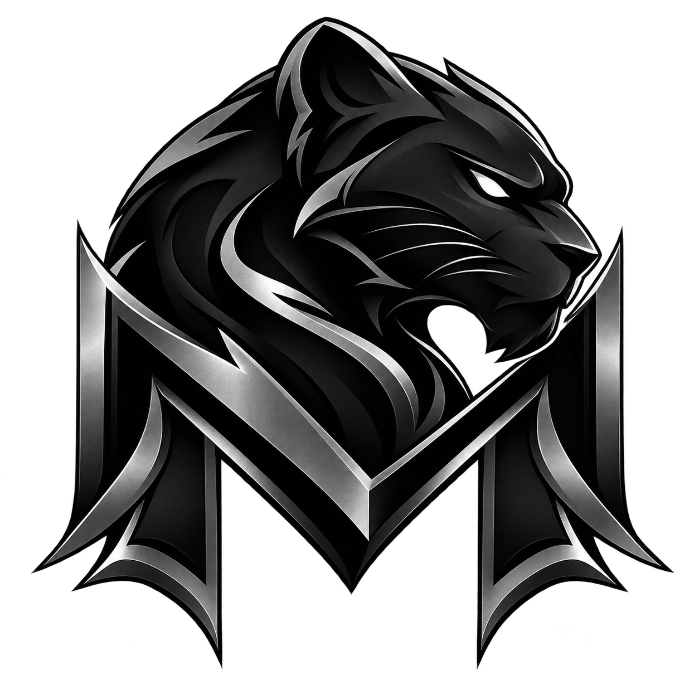

# BLACK-MAHURA
### WhatsApp Multi-Device Bot
**Owner: Saint**

A multi-device WhatsApp bot with group tools, media utilities, AI integrations, games, RPG/economy features, status tools and automated replies.

---

## Setup

1. Fork this repository to your GitHub account.
2. Deploy your fork using a Node.js hosting service that supports long-running processes.
3. Set the environment variables listed below in your hosting dashboard.
4. Start the service with `npm start` (or `npm run dev` for a basic local run).

## Environment variables

| Variable | Required | Purpose |
|---|---:|---|
| `SESSION_ID` | Yes | WhatsApp session credentials generated through the project's supported pairing flow. Keep this secret. |
| `OWNER_NAME` | No | Owner display name. Default: `Saint`. |
| `OWNER_NUMBER` | No | Owner's WhatsApp number, in international format. |
| `MODE` | Yes | `public` or `private`. |
| `TIME_ZONE` | Yes | IANA time zone, e.g. `Africa/Tripoli`. |
| `BOT_NAME` | No | Display name shown in menus. Default: `Black-Mahura`. |
| `FOOTER` | No | Footer shown in bot messages. Default: `Black-Mahura`. |
| `MALVIN_API_KEY` | Feature-dependent | Key for the upstream Malvin API integration used by some commands. This is a third-party service dependency, not the bot's brand name. |
| `DATABASE_URL` | No | PostgreSQL connection URL. If omitted, the project can use its local SQLite fallback where supported. |
| `AUTO_READ_STATUS` | No | `true` or `false`. |
| `AUTO_LIKE_STATUS` | No | `true` or `false`. |

Copy `.env.example` to `.env` for a local setup, then fill in your own values. **Never commit `.env`, session credentials, API keys, or passwords to a public repository.**

## Important dependencies

Some existing features still rely on upstream packages and services, including `mrxd-baileys`, `malvin-btns`, and the Malvin API/session endpoints. Their technical package names and environment-variable names are intentionally preserved so existing code continues to work. Changing those identifiers without replacing the underlying services would break features.

## Project identity

- Bot name: **Black-Mahura**
- Owner display name: **Saint**
- Logo: `assets/black-mahura-emblem.png`

## Upstream attribution

This project is a customized derivative of [MALVIN-XD](https://github.com/octocat/MALVIN-XD). Upstream package names, service endpoints, and required attribution are retained where needed for compatibility and source credit.
